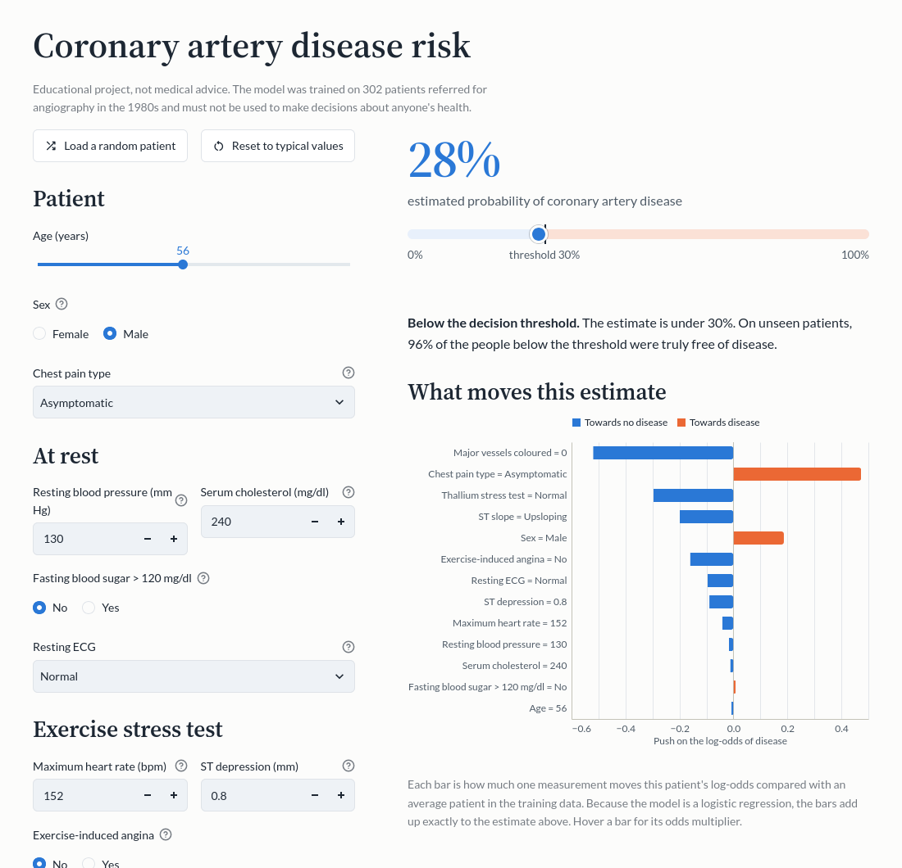
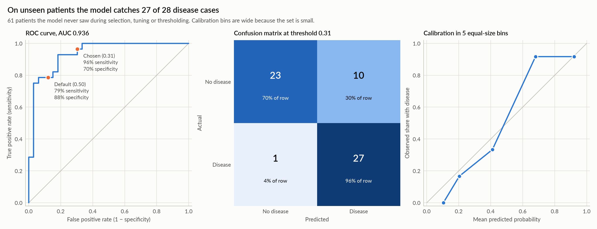
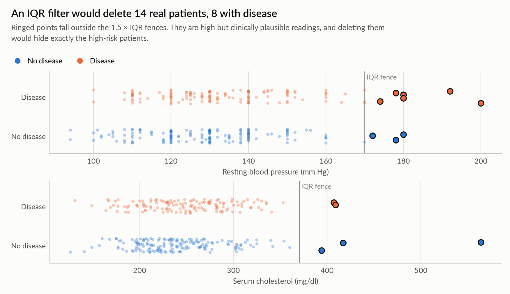
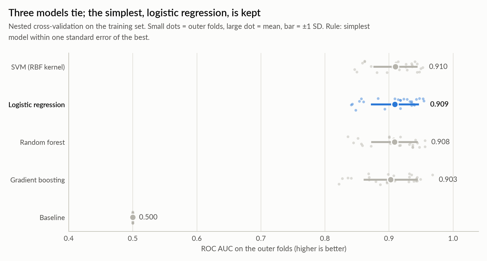
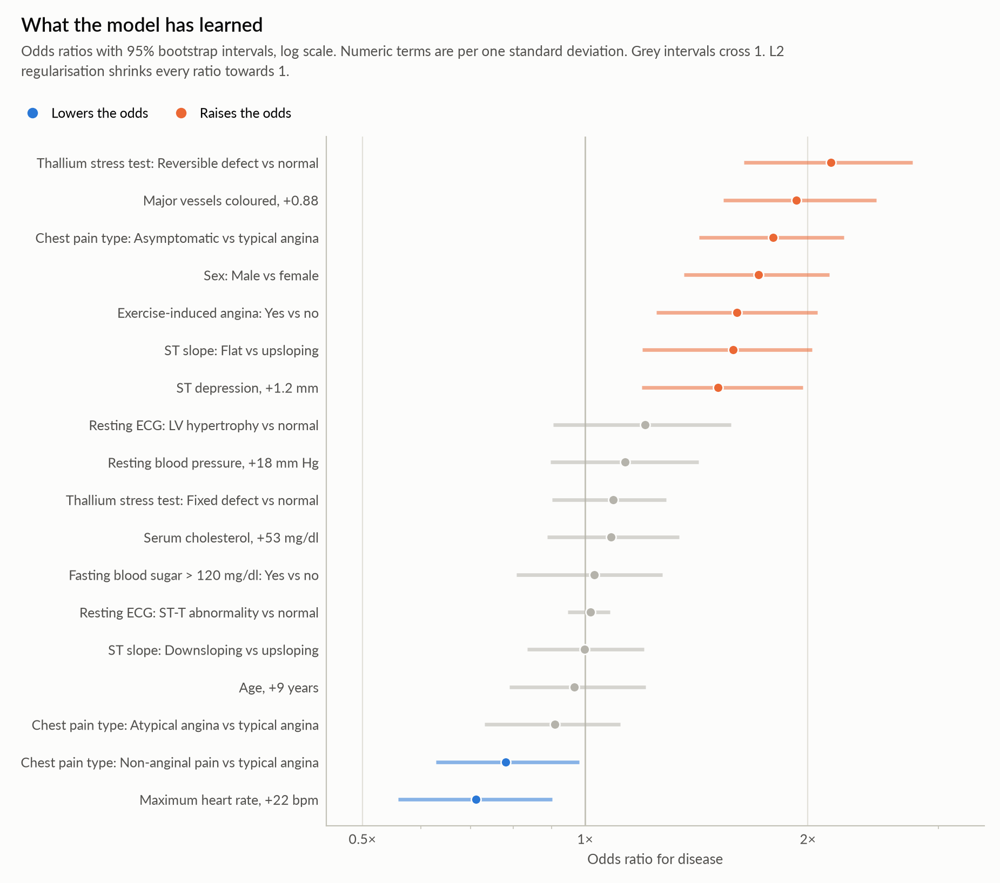
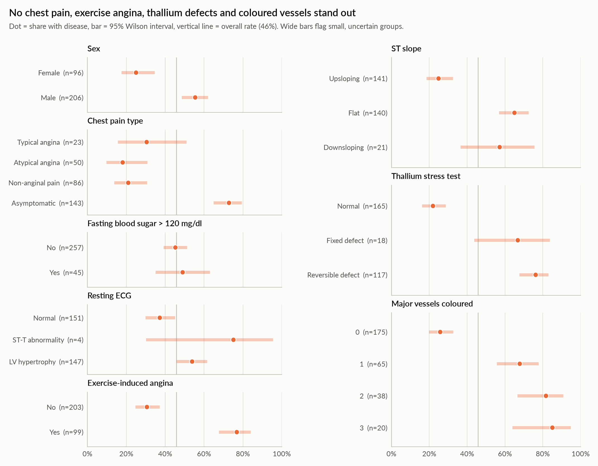

# Coronary Artery Disease Prediction

[](https://github.com/haadijafari/Heart-Attack/actions/workflows/ci.yml)


Predicting **coronary artery disease** from routine clinical measurements on the UCI Cleveland heart disease dataset. The project covers a full data audit, leakage-safe modelling with nested cross-validation, a decision threshold chosen for clinical use, an interpretable model, and an interactive Streamlit app.

> [!IMPORTANT]
> This is an educational portfolio project, **not medical advice**. The model was trained on 302 patients referred for angiography in the 1980s and must not be used to make decisions about anyone's health.



## Results

The model was selected and tuned on 241 patients. It was then scored once on 61 held-out patients it had never seen:

| Metric (held-out test set) | Estimate | 95% bootstrap interval |
|---|---|---|
| ROC AUC | **0.936** | 0.872 – 0.985 |
| Sensitivity: disease cases caught | **0.964** (27 of 28) | 0.893 – 1.000 |
| Specificity: healthy patients cleared | 0.697 | 0.545 – 0.848 |
| Negative predictive value | 0.958 | 0.870 – 1.000 |
| Brier score (lower is better) | 0.110 | 0.075 – 0.149 |

The nested cross-validation estimate on the training set, ROC AUC **0.909 ± 0.038**, is the more stable figure because the test set is small. The decision threshold (0.31) was chosen to catch at least 90% of disease cases, so the model accepts more false alarms in exchange for rarely missing a case.



## What makes this project different

The dataset is one of the most-used on Kaggle, where it is usually shared as a *"heart attack"* dataset. Taken at face value, it leads to several silent mistakes. This project starts by fixing them.

**The data is not what it looks like.** I recovered the true encoding by matching every row against the original UCI file. After decoding, all 302 unique Kaggle rows match a UCI patient exactly.

| Problem in the Kaggle `heart.csv` | Consequence if ignored | Fix |
|---|---|---|
| Categorical codes were remapped (e.g. `cp = 0` is *asymptomatic*, not typical angina) | Every interpretation of chest pain, ECG, ST slope and thallium results is wrong | Decode with the verified mapping in [`schema.py`](src/heart_disease/schema.py) |
| The target is inverted (`output = 1` means *no* disease) | "Sensitivity" and "precision" silently refer to the healthy class | `has_disease = 1 - output`, so disease is the positive class |
| Missing values hide behind codes (`caa = 4`, `thall = 0`) | Seven unknown values are treated as real measurements | Convert to `NaN` and impute inside the model pipeline |
| One patient is duplicated | The copy can land in both training and test sets | Drop exact duplicates |
| The target is described as "heart attack" | Readers think the model forecasts heart attacks | It is a **diagnosis** of coronary artery disease on angiography |

**Clinically plausible values are kept.** A 1.5 × IQR filter would delete 14 real patients, 8 of them with disease, including blood pressures of 180–200 mm Hg. Those are risk factors, not errors. The cleaning step validates **physiological ranges** instead and fails loudly on impossible values.



**The evaluation is honest:**

- A stratified 20% test set is locked away before any modelling.
- All preprocessing (imputation, scaling, one-hot encoding) lives inside a scikit-learn `Pipeline`, so it is refit on training folds only.
- Five candidates (a baseline, logistic regression, an RBF SVM, a random forest and gradient boosting) are compared with **nested** 5 × 5 repeated cross-validation, with hyperparameters tuned inside each outer fold.
- The **simplest model within one standard error** of the best is kept. Three models tie at AUC ≈ 0.91, so logistic regression wins on simplicity, calibration and interpretability.
- The decision threshold comes from **out-of-fold** predictions, never from the test set.
- Every test metric carries a **bootstrap confidence interval**.



**The model is interpretable.** Odds ratios with bootstrap intervals show what it has learned, and every prediction in the app decomposes exactly into per-feature contributions.



## The analysis notebook

[`notebooks/heart_disease_analysis.ipynb`](notebooks/heart_disease_analysis.ipynb) tells the whole story with outputs included:

1. Data provenance and what the target really means
2. The data audit, with evidence for every problem above
3. Cleaning
4. Exploratory analysis
5. Modelling protocol, model comparison and threshold selection
6. Test-set evaluation
7. Interpretation, including an explanation of the one disease case the model missed
8. Limitations

All of the logic lives in the tested `heart_disease` package, so the notebook stays readable and runs from top to bottom in CI on every push. To run it on Kaggle or Colab, uncomment the `pip install` line in its first code cell.



## The Streamlit app

```bash
uv run streamlit run app/streamlit_app.py
```

- **Risk estimate:** enter a patient's measurements, or load a random real patient, and see the estimated probability against the decision threshold. A chart shows which measurements push the estimate up or down. Imaging results can be marked as *not measured*.
- **Explore the data:** interactive distributions, disease rates with confidence intervals, and scatter plots, each with a table view.
- **Model performance:** the held-out test results, the model comparison and the threshold trade-off.
- **About the project:** the data, its pitfalls and the model's limits.

## Getting started

The project uses [uv](https://docs.astral.sh/uv/) and Python 3.12 or newer (3.14 is pinned for development).

```bash
git clone https://github.com/haadijafari/Heart-Attack.git
cd Heart-Attack
uv sync                                       # create .venv with all dependencies
uv run pytest                                 # run the test suite
uv run heart-train                            # retrain; writes models/model.joblib and models/metrics.json
uv run jupyter lab                            # open the analysis notebook
uv run streamlit run app/streamlit_app.py     # launch the app
```

`heart-train` takes a few minutes because of the nested cross-validation. `uv run heart-train --fast` compares only the baseline and logistic regression.

## Project structure

```text
├── app/                         Streamlit app (one file per page)
├── data/raw/heart.csv           the Kaggle file, unchanged
├── models/                      trained model and its metrics (written by heart-train)
├── notebooks/                   the analysis notebook
├── reports/figures/             figures written by the notebook, used here and in the app
├── src/heart_disease/
│   ├── schema.py                column names, meanings, units, verified code mappings, valid ranges
│   ├── data.py                  loading, validation and cleaning
│   ├── features.py              leakage-safe preprocessing pipeline
│   ├── models.py                candidate models and hyperparameter grids
│   ├── evaluation.py            nested CV, model selection, threshold choice, bootstrap intervals
│   ├── interpretation.py        disease rates with Wilson intervals, odds ratios
│   ├── artifact.py              the saved model: thresholded predictions and exact explanations
│   ├── plots.py                 every chart, in one consistent style
│   └── train.py                 the heart-train command
└── tests/                       unit, integration and app tests
```

## Data

**Source:** the Cleveland subset of the [UCI Heart Disease dataset](https://archive.ics.uci.edu/dataset/45/heart+disease), as redistributed on Kaggle as the [Heart Attack Analysis & Prediction Dataset](https://www.kaggle.com/datasets/rashikrahmani/heart-attack-analysis-prediction-dataset). It covers 303 rows (302 unique patients) referred for coronary angiography at the Cleveland Clinic in 1981–1984.

| Column | Raw name | Meaning |
|---|---|---|
| `age` | `age` | Age in years |
| `sex` | `sex` | Female or male |
| `chest_pain` | `cp` | Typical angina, atypical angina, non-anginal pain or asymptomatic |
| `resting_bp` | `trtbps` | Resting systolic blood pressure (mm Hg) |
| `cholesterol` | `chol` | Serum cholesterol (mg/dl) |
| `high_fasting_sugar` | `fbs` | Fasting blood sugar above 120 mg/dl |
| `rest_ecg` | `restecg` | Resting ECG: normal, ST-T abnormality or left ventricular hypertrophy |
| `max_heart_rate` | `thalachh` | Highest heart rate reached on the exercise test (bpm) |
| `exercise_angina` | `exng` | Angina brought on by the exercise test |
| `st_depression` | `oldpeak` | ST depression induced by exercise relative to rest |
| `st_slope` | `slp` | Slope of the peak-exercise ST segment: upsloping, flat or downsloping |
| `major_vessels` | `caa` | Major vessels (0–3) coloured by fluoroscopy |
| `thal` | `thall` | Thallium stress test: normal, fixed defect or reversible defect |
| `has_disease` | `output` (inverted) | More than 50% narrowing of at least one major coronary artery |

## Limitations

- **Small, old, single-centre data.** 302 patients from one hospital in the early 1980s.
- **Referral population.** 46% of these patients had disease, far more than in the general population. Probabilities apply to similar, already-referred patients and would need recalibration elsewhere.
- **Specialist inputs.** The thallium scan, fluoroscopy and exercise test belong to a cardiac work-up, so this is a decision aid within that work-up, not a screening tool.
- **Small test set.** 61 patients give wide intervals.
- **No external validation yet.** UCI also hosts data from Hungary, Switzerland and Long Beach. Validating there is the natural next step.

## Contributing

Contributions are welcome. Please follow the commit and branching conventions in [CONTRIBUTING.md](CONTRIBUTING.md).

## Citation

- Janosi, A., Steinbrunn, W., Pfisterer, M., & Detrano, R. (1989). *Heart Disease* [Dataset]. UCI Machine Learning Repository. https://doi.org/10.24432/C52P4X
- Detrano, R., et al. (1989). International application of a new probability algorithm for the diagnosis of coronary artery disease. *The American Journal of Cardiology*, 64(5), 304–310.

## License

The code is released under the [MIT License](LICENSE). The UCI dataset is licensed under [CC BY 4.0](https://creativecommons.org/licenses/by/4.0/).
